  

  
  
  
  

  Estudiante de 2.º año de <b>Análisis de Sistemas y Desarrollo de Software</b> en el IES N.º 6001 "Manuel Belgrano" y desarrollador
  <b>full-stack</b> con foco en <b>backend</b>. Construyo APIs REST con <b>Python y FastAPI</b>, modelo bases de datos en <b>PostgreSQL</b>
  y armo interfaces con <b>React</b>. Fui backend de <a href="https://github.com/Antony27c/Boxly"><b>Boxly</b></a>, sistema de gestión para
  talleres mecánicos que ganó el <b>1.º puesto a nivel institucional</b> y está certificado por el instituto y <b>SaltaDev</b>.

<h2 align="center">Stack tecnológico</h2>

  
  
  
  
  
  
  
  
  
  
  
  
  
  
  
  
  
  

<h2 align="center">Proyectos destacados</h2>

| Proyecto | Qué es | Stack |
|:--|:--|:--|
| [**Boxly**](https://github.com/Antony27c/Boxly) | Gestión de taller mecánico. Hice el módulo de órdenes de trabajo, su máquina de estados, turnos, horarios y métricas. **1.º puesto institucional.** | FastAPI · PostgreSQL · React |
| [**Gestión de Inventario**](https://github.com/GabrielUlunqui/Sistema-de-gestion-de-inventario) | Stock de productos de seguridad electrónica con alertas de stock bajo y dashboard. | FastAPI · SQLite · React |
| [**Sitio S.I.S en PHP**](https://github.com/GabrielUlunqui/Programacion-Web) | Sitio corporativo con panel de administración, autenticación, AJAX y MVC. | PHP · MySQL · Laravel |
| [**Portfolio**](https://github.com/GabrielUlunqui/tp1-mi-sitio) | Mi sitio personal. [Ver online](https://gabrielulunqui.github.io/tp1-mi-sitio/) | React · Tailwind · Vite |

<h2 align="center">Estadísticas de GitHub</h2>

  
  

  

<h2 align="center">Contacto</h2>

  
  
  
  
  

<i>Salta, Argentina · Abierto a nuevas oportunidades como desarrollador</i>

